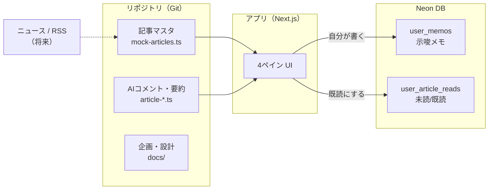
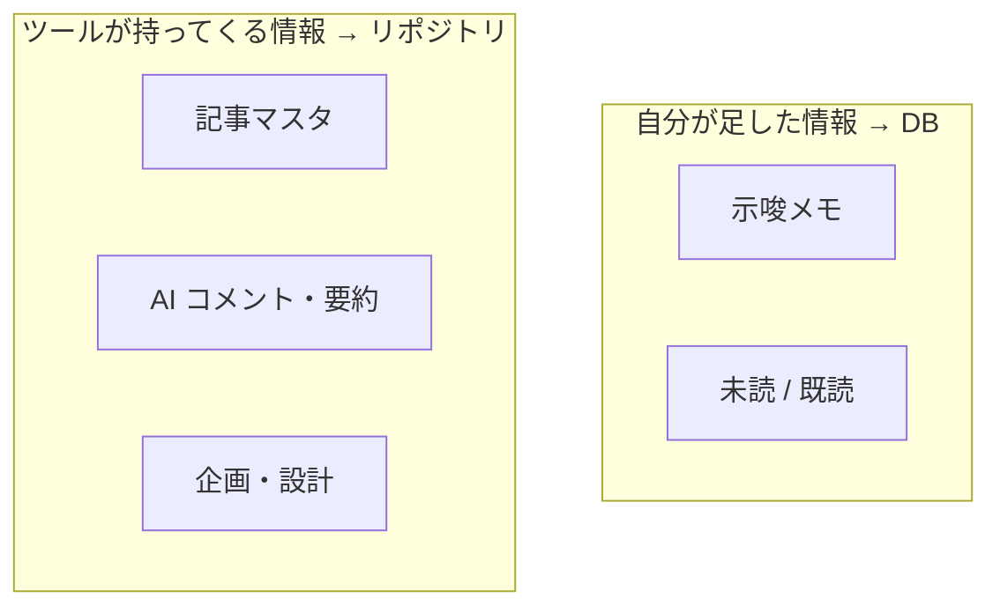

# 4ヶ月目 — データ保存設計（grill-me 合意）

セキュリティトレンド・デスクで「何を・どこに保存するか」の決定ログ。第4回グループセッション・月次課題用。

---

## 自分の言葉での説明（発表用たたき）

> 記事本文はニュース/RSS から取る想定なので、DB には載せない。  
> DB に載せるのは **自分が足した情報** — 示唆メモと未読/既読だけ。  
> 記事マスタや AI コメントの型は **リポジトリ** に残し、AI と設計を共有しやすくする。

---

## grill-me で決まったこと

| 論点 | 決定 |
|------|------|
| リロード後も残すデータ | **示唆メモ + 未読/既読** |
| 利用者 | **自分1人**（将来ログインを見据え `user_id` 列を用意、今は `default`） |
| 記事データ | **リポジトリ / 将来 RSS** — DB に保存しない |
| AIコメント・要約・X反応 | **リポジトリ**（`article-ai-comments.ts` / `article-insights.ts`） |
| 設計・企画の説明 | **リポジトリ**（`docs/`、`README.md`） |
| DB | **Neon**（`DATABASE_URL`） |

---

## テーブル設計

### `user_memos` — 示唆メモ

| 列 | 型 | 説明 |
|----|-----|------|
| `user_id` | TEXT | 将来の認証用。現状は `'default'` 固定 |
| `article_id` | TEXT | 記事 ID（将来 RSS 導入後も同じキーで紐付け） |
| `content` | TEXT | メモ本文 |
| `updated_at` | TIMESTAMPTZ | 最終更新 |

**主キー:** `(user_id, article_id)`

### `user_article_reads` — 既読

| 列 | 型 | 説明 |
|----|-----|------|
| `user_id` | TEXT | 同上 |
| `article_id` | TEXT | 記事 ID |
| `read_at` | TIMESTAMPTZ | 既読にした日時 |

**主キー:** `(user_id, article_id)`

---

## なぜ2表に分けたか

- メモは **長文・編集頻度高** → 1記事1行で upsert
- 既読は **フラグ＋日時** → 選択時に1行 insert（重複は PK で防ぐ）
- 将来「メモだけエクスポート」などしやすい

---

## 図解（4ヶ月目提出物）

### ブラウザで見る

- **公開 URL:** https://diagram-sectrend-storage.surge.sh/
- ローカル: `docs/diagram-storage/index.html` をブラウザで開く

Surge 等で公開する例:

```bash
npx surge docs/diagram-storage --domain diagram-sectrend-storage.surge.sh
```

### 保存設計の全体像（Mermaid）



### 2分けの軸



---

## 未決・今後

- [ ] RSS/API 連携時：記事 ID を URL ハッシュ等に統一
- [ ] 認証導入時：`user_id` をログインユーザー ID に差し替え
- [ ] Vercel 公開（ステップ⑤）
- [x] 図解に「保存データ・保存先・理由」を追記 → [diagram-storage/index.html](./diagram-storage/index.html)

---

## 関連

- [sectrend-desk-plan.md](./sectrend-desk-plan.md) — 3ヶ月目企画
- `scripts/schema.sql` — テーブル定義
- `.env.example` — `DATABASE_URL` の例
